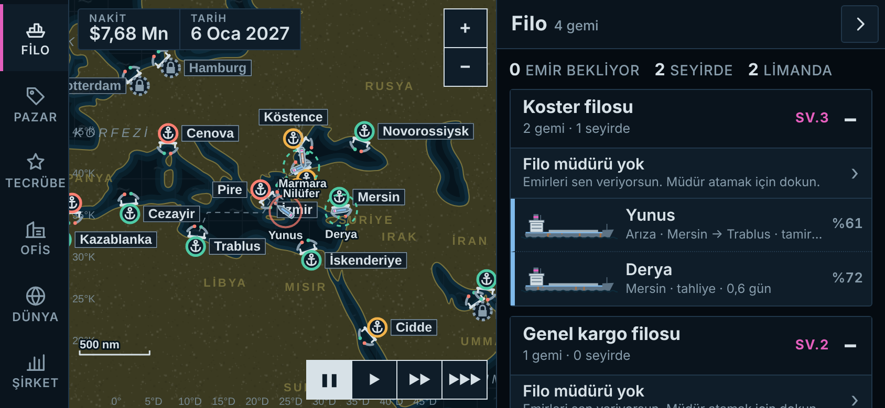
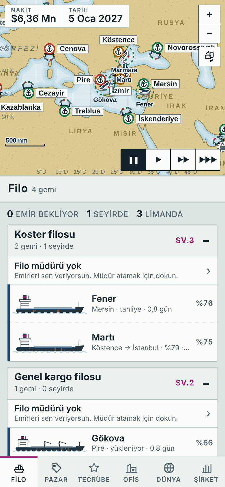

# Armatör

**Tarayıcıda oynanan bir denizcilik şirketi oyunu.** Tek bir eski kosterle, rıhtımda kiralık bir odada başlarsın. Dünya limanları arasında yük taşır, personelini seçer, gemilerini ayakta tutar, denizin kurallarıyla ve dünyanın gündemiyle uğraşırsın. Yıllar içinde şirketini tanker, konteyner ve LNG filolarına, şehrin siluetine giren bir denizcilik kulesine kadar büyütürsün.

Türkçe, English ve 中文 oynanır. Telefonda, tablette ve bilgisayarda çalışır; kurulum gerekmez.

## Oyun baştan sona

### İlk gün

Şirketine bir ad verirsin. Kasanda bir kosterlik para, ofisinde tek bir masa vardır. Kısa bir rehberli tur düğmeleri gösterir. Pazardan ilk gemini seçersin: yaşı, durumu, hızı ve yakıt tüketimi fiyatını belirler. Sonra mürettebatını kurarsın: kaptan, 2. kaptan, çarkçıbaşı, 2. çarkçı ve aşçı. Tecrübeli denizci pahalıdır ama işini iyi yapar. İyi kaptan gemiyi hızlı götürür, iyi çarkçıbaşı yakıt ve arızayı azaltır, iyi aşçı gemideki morali tutar.

### İlk sefer

Limandaki yük listesinde her yükün cinsi, tonajı, gideceği liman, süresi, navlunu ve tahmini kârı yazar. Bir yük seçersin; gemi yükler, harita üzerinde gerçek deniz yollarından, boğazlardan ve kanallardan geçerek yol alır, varınca tahliye eder. Navlun teslimde ödenir. Bu arada maaşlar, işletme giderleri, yakıt ve liman masrafları her gün işler; boş bekleyen gemi para yakar. Limanda iyi yük yoksa yükün bol olduğu bir limana boş sefer yaparsın.

Limanlarda kuyruk olur, bazen grev çıkar. Yükleme ve tahliye anlaşılan süreyi (laytime) aşarsa kiracı sana demuraj öder; erken bitirirsen sen dispeç ödersin. Geç teslim ceza getirir, kötü hava ve dikkatsiz yükleme yük hasarına yol açar.

### Denizde

Seyir her zaman sakin geçmez. Makine arıza yapar: mürettebat tamir etmeye çalışır ya da servis çağırırsın. Haritada gerçekten dolaşan kasırgalar, tayfunlar ve kış fırtınaları vardır; mevsime göre değişir, musonlar Hint Okyanusu'nu zorlaştırır. Sintine tankı dolar ve yağlı suyu ne yapacağına sen karar verirsin. Denize basmak ucuzdur ama yasadışıdır; yakalanmasan bile bir gün eski bir denizci ihbar edebilir. Bazen yakınlardaki bir gemiden imdat çağrısı gelir: yardıma gidersen zaman kaybedersin ama kurtarma ödülü ve itibar kazanırsın.

### Limanda

Her ülkenin liman devleti denetimi farklı sıkılıktadır. Gevşek limanlar eski gemiye göz yumar ama az öder; sıkı limanlar iyi öder ama kötü durumdaki gemiyi tutar ve ceza keser. Gemiler zamanla yıpranır: bakım ve havuz yaptırırsın. Klas sörveyleri iki buçuk yılda bir gelir; kaçırırsan klas askıya alınır ve gemi yük alamaz. Yakıt fiyatı limandan limana değişir, ucuz limanda depoyu doldurmak kârı büyütür.

### Personel

Denizciler 4–8 aylık sözleşmeyle çalışır. Sözleşme dolunca havalimanı olan bir limanda değişim yaparsın; izne çıkan denizci sana bağlıysa birkaç ay sonra geri döner. Sözleşmeyi çok uzatırsan moral düşer, denizci gemiyi terk eder ve dava açabilir. Mürettebatın yaşlanır, emekli olur, terfi ister, zam ister; rakip şirketler iyi kaptanını ayartmaya çalışır. Kadet programıyla kendi zabitlerini ve çarkçılarını yetiştirirsin: daha ucuz ve sana daha bağlı olurlar.

### Büyümek

Her teslimat geminin sınıfında tecrübe kazandırır. Tecrübe arttıkça navlun artar, liman işleri hızlanır, yeni gemi ruhsatları, büyük limanlar ve gemi geliştirmeleri (pervane, makine revizyonu, scrubber, yük donanımı, yaşam mahalli) açılır. Koster ve genel kargodan dökme yüke, tankere, konteynere, araç taşıyıcıya ve LNG'ye uzanan 12 gemi sınıfı vardır.

Para yetmezse bankaya gidersin: işletme kredisi çekebilir, gemiyi yarı peşin yarı krediyle alabilirsin. Gemiyi zaman çarterine verip sabit günlük kira da alabilirsin. Gemi yaşlanınca satar ya da söküme gönderirsin; yenisi için ikinci el pazara bakar ya da tersaneye sıfır gemi ısmarlarsın.

### Şirket

Ofisin beş binadan geçer: rıhtımdaki tek odadan iş hanına, müstakil ofise, genel müdürlüğe ve denizcilik kulesine. Bina büyüdükçe dışı ve içi değişir, daha çok çalışan ve gemi sığar. Makine enspektörü bakımı takip eder, dış ilişkiler müdürü ülkelerle ilişkini yürütür, hukuk müşaviri davaları üstlenir. On beş teslimattan sonra filolara müdür atayabilirsin: yükü senin yerine bulurlar; iyisi kâr ettirir, kötüsü zarar.

Şirket seviyesi yükseldikçe yoğun limanlarda kendi rıhtımını alıp terminale büyütebilirsin: orada gemilerin kuyruk beklemez, başka şirketlerin gemileri de sana para kazandırır. Dört rakip şirket de büyür, zorlanır, batar; zor durumdakini satın alabilirsin.

### Dünya

Her ülkeyle ilişkin vardır. İlişki iyiyse navlun artar, masraf ve denetim azalır; çok kötüleşirse limanlar kapanır. Kurgusal kriz, boykot ve yaptırım olaylarında taraf seçersin ya da tarafsız kalırsın. Kızıldeniz, Aden Körfezi, Gine Körfezi, Hürmüz ve Kuzey Karadeniz'in risk seviyesi zamanla değişir; savaş riski sigortası, silahlı koruma ya da Ümit Burnu'ndan dolaşmak arasında seçim yaparsın.

### Kurallar

Her yıl sonunda gemilerin A'dan E'ye bir karbon notu alır ve kurallar her yıl sıkılaşır. E notlu gemi Avrupa Birliği limanlarına giremez; AB seferlerinde yakılan yakıtın karbon bedeli ödenir. Ekonomik seyir, bakım, yeni gemi ve LNG yakıt notu iyileştirir.

Deniz kurallarına aykırı davranırsan şirketine dava açılır. Yük hasarı, çatışma ve rıhtım kazaları da mahkemeye gidebilir. Her davada uzlaşır ya da mahkemede savunursun; davası süren gemin limanda tutuklanabilir.

### Öğrenmek

Oyunu adım adım öğreten 22 görev vardır; her biri bir ödül verir. Yeni bir şeyle ilk kez karşılaştığında kısa bir ipucu çıkar. Oyun uzun soluklu düşünülmüştür: büyük gemiler ve büyük limanlar yıllar içinde açılır.

## Ekran ve ses

Dikey ve yatay iki düzen vardır; ana ekrana eklenince uygulama gibi tam ekran ve internetsiz açılır. Açık, koyu ve otomatik tema, oyun içinde üretilen sakin bir denizci müziği ve dalga sesi vardır. Oyun kendini tarayıcıya kaydeder; kayıt dosyası dışarı alınıp başka cihaza taşınabilir.

Oyundaki politik olaylar kurgusaldır. Fiyatlar ve süreler oyun dengesi için seçilmiştir, gerçek piyasa verisi değildir.

---

## English

**Armatör** (“shipowner”) is a shipping company game that runs in the browser, in Turkish, English and Chinese.

**Day one.** You name your company and start with enough cash for one old coaster and a single desk in a rented room on the quay. A short guided tour shows you the buttons. You pick your first ship from the market, then hire a crew: master, chief officer, chief engineer, second engineer and cook. Experienced seafarers cost more but do better work: a good master is faster, a good chief engineer saves fuel and prevents breakdowns, a good cook keeps morale up.

**The first voyage.** Each port lists cargoes with their type, tonnage, destination, deadline, freight and estimated profit. Your ship loads, sails real sea lanes through straits and canals, and discharges. Freight is paid on delivery, while wages, running costs, fuel and port fees accrue every day, so an idle ship loses money. Ports have queues and strikes; go over laytime and the charterer pays you demurrage, finish early and you pay despatch.

**At sea.** Engines break down. Hurricanes, typhoons and winter gales move across the map with the seasons, and the monsoon makes the Indian Ocean hard work. You decide what to do with oily bilge water: pumping it overboard is cheap and illegal, and a former crew member may report it years later. A distress call may come from a nearby ship; helping costs time but earns a salvage award and reputation.

**In port.** Port State Control is lax in some countries and strict in others. Lax ports pay little; strict ports pay well but detain ships in poor condition. Ships wear out and need maintenance and drydocking, and class surveys fall due every two and a half years. Fuel prices differ from port to port.

**Crew.** Seafarers work 4–8 month contracts and must be relieved at ports with an airport. Keep them on too long and they walk off and may sue. Crew age, retire, ask for promotions and raises, and rivals try to poach your best master. A cadet programme lets you train your own loyal officers.

**Growing.** Every delivery earns experience in the ship's class, unlocking higher freight, faster port work, new licences, bigger ports and upgrades across 12 classes, from coasters to bulk carriers, tankers, container ships, car carriers and LNG carriers. You can borrow from the bank, buy ships half on credit, charter them out, sell or scrap old tonnage, and order newbuildings from shipyards.

**The company.** Your office moves through five buildings, from a room on the quay to a maritime tower. You hire a technical superintendent, an external relations manager and a legal counsel; after 15 deliveries you can appoint fleet managers who find cargo for you, well or badly. Later you can buy your own berths and grow them into terminals, and take over struggling rivals.

**The world and its rules.** Relations with each country raise or lower freight, costs and inspections, and fictional crises ask you to take sides. Risk levels in the Red Sea, the Gulf of Aden, the Gulf of Guinea, Hormuz and the northern Black Sea change over time; you choose war-risk insurance, armed guards or the long way round the Cape. Ships get a yearly carbon rating from A to E, E-rated ships are barred from the EU, and EU voyages pay for their emissions. Breaking the rules of the sea, cargo damage, collisions and quay accidents lead to lawsuits that you can settle or fight in court, and a ship with a pending case can be arrested in port.

**Learning.** 22 missions with rewards teach the game step by step, and short tips appear the first time you meet something new. The game is designed to be played over a long time.

---

## 中文

**Armatör**（土耳其语“船东”）是一款在浏览器中运行的航运公司经营游戏，支持土耳其语、英语和中文。

**第一天。** 给公司起个名字。你的钱只够买一艘旧沿海货船，办公室只是码头边租来的一个单间。简短的新手引导会介绍各个按钮。你从市场挑选第一艘船，再招募船员：船长、大副、轮机长、大管轮和厨师。有经验的船员更贵，但更能干：好船长航速快，好轮机长省油少故障，好厨师能稳住士气。

**第一个航次。** 每个港口都列出货物的种类、吨数、目的港、期限、运费和预计利润。船舶装货后沿真实航道穿过海峡和运河，抵达后卸货。运费在交货时支付，而工资、运营费、燃油和港口费每天都在产生，闲置的船就是在亏钱。港口会排队、会罢工；超出装卸时间由租船人付滞期费，提前完成则由你付速遣费。

**海上。** 主机会出故障。飓风、台风和冬季风暴随季节在地图上移动，季风让印度洋航行更艰难。含油舱底水怎么处理由你决定：排进海里便宜但违法，多年后可能被前船员举报。附近船舶可能发来求救信号；前往救援会耽误时间，但能获得救助报酬和声誉。

**港口。** 各国港口国监督松紧不一。宽松的港口运费低；严格的港口运费高，但会滞留船况差的船。船舶会磨损，需要维修和进坞，每两年半要做一次船级检验。各港油价也不同。

**船员。** 船员签4到8个月的合同，到期后要在有机场的港口换班。拖得太久，船员会离船甚至起诉。船员会变老、退休、要求晋升和加薪，对手公司还会挖走你最好的船长。通过实习生计划，你可以培养自己忠诚的驾驶员和轮机员。

**成长。** 每次交货都为该船型积累经验，带来更高运费、更快装卸、新执照、更大的港口和各种改装。共有12个船型，从沿海货船到散货船、油轮、集装箱船、汽车滚装船和LNG船。你可以向银行贷款、一半贷款买船、把船期租出去、出售或拆解旧船，也可以向船厂订造新船。

**公司。** 办公室会经历五栋楼，从码头边的单间一直到航运大厦。你可以聘请机务主管、对外关系经理和法律顾问；完成15次交货后还能任命船队经理替你找货，经理有好有坏。之后可以购买自己的泊位并扩建成码头，还能收购陷入困境的对手。

**世界与规则。** 与各国的关系会影响运费、费用和检查，虚构的危机会要求你选边站。红海、亚丁湾、几内亚湾、霍尔木兹和黑海北部的风险等级不断变化；你可以选择战争险、武装护卫，或绕行好望角。船舶每年获得A到E的碳评级，E级船不得进入欧盟，往返欧盟的航次要为排放付费。违反海上规则、货损、碰撞和码头事故都会招来诉讼，你可以和解，也可以出庭应诉；有未决案件的船可能在港口被扣押。

**学习。** 22个带奖励的任务会一步步教你玩法，第一次遇到新情况时会出现简短提示。这是一款适合长期经营的游戏。
