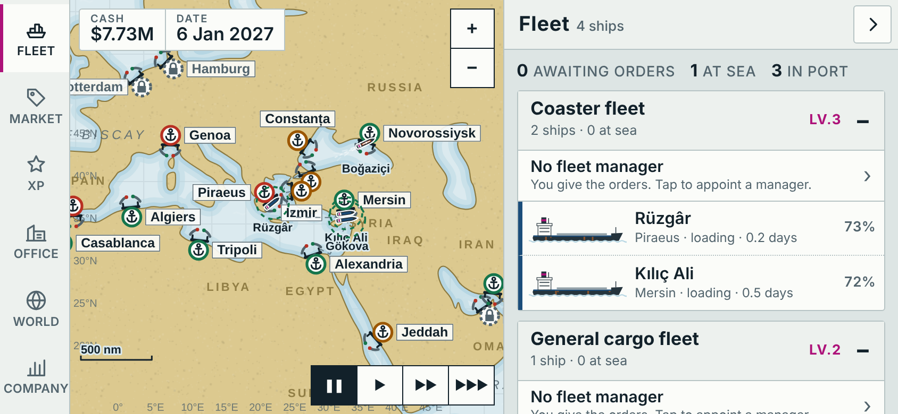
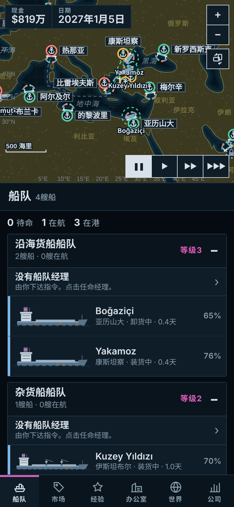

# Armatör

Tarayıcıda oynanan bir denizcilik şirketi oyunu. **Türkçe, English, 中文** dillerinde oynanır. Tek bir eski kosterle başlarsın; dünya limanları arasında yük taşır, personelini seçer, tecrübe kazanır ve şirketini tanker filolarına kadar büyütürsün.

Kurulum gerekmez: telefonda, tablette ya da bilgisayarda tarayıcıdan açılır. İstersen ana ekrana ekleyip uygulama gibi, internetsiz de oynayabilirsin.


## Nasıl oynanır

1. Şirketine bir ad ver ve pazardan ilk kosterini al.
2. Gemiye personel ata. Tecrübeli personel pahalıdır; tecrübesiz olan ucuzdur ama işini daha zor yapar.
3. Gemiyi **Sevk et** ile limandaki en kârlı ve güvenli yüke gönder ya da yükü kendin seç. Eksik yakıt ve kumanya tek dokunuşla tamamlanır.
4. Navlun, yük teslim edilince ödenir. Maaşlar, işletme giderleri ve liman masrafları her gün işler; boş bekleyen gemi para kaybettirir.
5. Her teslimat geminin sınıfında tecrübe kazandırır. Tecrübe arttıkça yeni gemi ruhsatları, büyük limanlar ve gemi geliştirmeleri açılır.
6. Ofisini büyüt, filo müdürleri ve makine enspektörü işe al, işi otomatiğe bağla.

Gemi emir beklerken oyun durur ve seni uyarır. Haritada bir gemiye ya da limana dokununca ayrıntısı açılır.

## Dil

Oyun Türkçe, İngilizce ve Çince (basitleştirilmiş) oynanabilir. İlk açılışta telefonun ya da tarayıcının diline göre seçilir; giriş ekranından, ekran yönü sorusundan ya da **Ayarlar › Dil** bölümünden istediğin zaman değiştirebilirsin. Seçim tarayıcıda saklanır.

Dil değişince seyir defteri, olaylar ve haritadaki adlar da yeni dilde görünür. Bu sürümden önce başlatılmış kayıtlarda eski defter satırları Türkçe kalır.

## Özellikler

- **12 gemi sınıfı, 5 tip:** koster, genel kargo, Handysize, Supramax ve Panamax dökme yük, küçük ürün tankeri, MR ve Aframax tanker, feeder ve Panamax konteyner, araç taşıyıcı (Ro-Ro), LNG tankeri. Her tipin kendi yükleri ve limanları var; tehlikeli madde (IMO) konteynerleri için gemide belge gerekir.
- **Yeni inşa ve hurda:** Dört tersaneden sıfır gemi siparişi (1–2 yıl, üç taksit, ekonomik makine ve scrubber seçeneği). Yaşlı gemiler Aliağa, Alang ya da Chittagong'da çelik fiyatından hurdaya satılır.
- **Hava ve mevsimler:** Haritada hareket eden kasırga, tayfun, kış fırtınası, poyraz ve muson. Fırtınadaki gemi yavaşlar ve yıpranır, sert havada liman işi durur.
- **Laytime ve demuraj:** Limanlarda kuyruk ve grevler. Laytime aşılırsa demuraj alırsın, erken bitirirsen dispeç ödersin.
- **34 liman ve gerçek deniz yolları:** Boğazlar, Süveyş ve Panama kanalları, Ümit Burnu, Aden Körfezi.
- **Liman devleti denetimi:** Denetimi gevşek limanlar eski gemiye göz yumar ama az öder; sıkı limanlar iyi öder, bakımsız gemiyi tutar.
- **Personel:** Kaptan, 2. kaptan, çarkçıbaşı, 2. çarkçı ve aşçı. Beceri, maaş ve moral oyunu doğrudan etkiler. Her denizcinin yaşı ve sadakati var: terfi ister, emekli olur, yılsonu ikramiyesi bekler, sadakatsiz olan istifa eder.
- **Banka:** İşletme kredisi ve yarı peşin, yarı kredili gemi alımı. Faiz itibara bağlı, taksitler her ay ödenir.
- **Zaman çarteri:** Gemiyi 3, 6 ya da 12 aylığına sabit günlük kirayla bir kiracıya ver; arızada kira kesilir (off-hire).
- **Klas sörveyleri:** 2,5 yılda bir ara, 5 yılda bir özel sörvey. Kaçırılırsa klas askıya alınır ve gemi yük alamaz.
- **Rakip şirketler:** Dört rakip büyür, zorlanır, batar. Personelini ayartır, navlun savaşı açar, ucuz gemi satar; batmak üzere olanı satın alabilirsin.
- **Seyirde olaylar:** Makine arızası, fırtına, sintine ve yağlı su kararı, korsan riski, yakıtsız kalma.
- **Tecrübe ve ruhsat:** Her gemi sınıfında ayrı tecrübe puanı var. Yeni sınıf için ruhsat, büyük limanlar için şirket seviyesi gerekir.
- **Gemi geliştirmeleri:** Pervane, makine revizyonu, scrubber, yük donanımı, kapasite artırımı ve diğerleri. Gövde boyası ve gemi adı da değiştirilebilir.
- **Ofis binası:** 5 seviye. Bina büyüdükçe dışı ve içi değişir; kadro ve yönetilebilecek gemi sayısı artar.
- **Otomasyon:** Filo müdürleri yükü senin yerine bulur, iyisi kâr ettirir, kötüsü zarar. Makine enspektörü bakım zamanı gelince sorar.
- **Ülkeler ve gündem:** Her ülkeyle ilişki puanın var. Kurgusal politik olaylarda verdiğin kararlar navlunu, liman masraflarını ve limanların açık olup olmadığını etkiler.
- **Karbon kuralları:** Her gemi yıl sonunda A–E karbon notu (CII) alır, kurallar her yıl sıkılaşır. E notlu gemi AB limanlarına giremez. AB seferlerinde karbon bedeli. Ekonomik seyir ve LNG yakıtlı yeni inşa.
- **Terminaller:** Limanlarda rıhtım alıp terminale büyüt. Kendi terminalinde kuyruk yok, liman masrafı düşük; başka şirketlerin gemileri aylık gelir getirir.
- **Sözleşmeler ve kadetler:** Denizciler 4–8 aylık sözleşmeyle çalışır; değişim havalimanı olan limanlarda yapılır. Kadet programıyla kendi 2. kaptan ve çarkçılarını yetiştir.
- **Riskli bölgeler:** Kızıldeniz, Aden, Gine Körfezi, Hürmüz ve Kuzey Karadeniz. Savaş riski sigortası, silahlı koruma ya da Ümit Burnu'ndan dolaşma. İmdat çağrıları, kurtarma ödülü ve müşterek avarya.
- **Uzun soluklu:** Tecrübe yavaş birikir; büyük gemi sınıfları ve büyük limanlar yıllar içinde açılır. Oyun iki hızda oynanır.
- **Rehberli tur:** İlk oyunda düğmeleri adım adım gösteren, ilk gemiyi aldırıp ilk sefere çıkaran kısa bir eğitim. Ayarlar'dan yeniden başlatılabilir.
- **Dil:** Türkçe, İngilizce ve Çince. Sayılar, para ve tarihler seçilen dile göre yazılır.
- **Müzik ve deniz sesi:** Oyun çalarken üretilen sakin bir denizci havası ve dalga sesi. Dosya indirilmez, internetsiz çalışır; Ayarlar'dan ayrı ayrı açılıp kapatılır.
- **Ekran:** Dikey ve yatay düzen, Ayarlar'dan seçilen açık, koyu ya da otomatik tema, tam ekran, çevrimdışı oynama.

## Telefonda oynamak

- **Ana ekrana ekle:** Android'de Chrome menüsünden “Ana ekrana ekle”, iPhone'da Safari'de Paylaş › “Ana Ekrana Ekle”. Oyun tam ekran açılır ve internetsiz de çalışır.
- **Dikey ya da yatay:** İlk açılışta hangisini istediğin sorulur. Haritadaki döndürme düğmesiyle ya da Ayarlar sekmesinden değiştirebilirsin. Yatay seçince destekleyen tarayıcılarda oyun tam ekrana geçip ekranı yatay kilitler; desteklemeyenlerde telefonu sola yatırarak tutman yeterli.
- **Bilgisayarda:** 1–7 tuşları bölümler arasında geçer, boşluk tuşu zamanı durdurur ve başlatır, Esc açık pencereyi kapatır.

## Kayıtlar

Oyun kendini tarayıcının yerel depolamasına kaydeder; hiçbir veri bir sunucuya gönderilmez. Tarayıcı verilerini silersen kayıt da silinir.

Kaydını başka bir cihaza taşımak ya da yedeklemek için **Ayarlar › Kayıt** bölümünden kaydı dosya olarak indir, diğer cihazda **Kayıt yükle** ile aç.

## GitHub Pages ile yayınlamak

1. Bu klasördeki her şeyi bir GitHub deposuna yükle. `index.html` deponun en üst klasöründe olmalı.
2. Depoda **Settings › Pages** bölümüne gir. “Build and deployment” altında kaynak olarak **Deploy from a branch**, dal olarak **main** ve klasör olarak **/ (root)** seç, kaydet.
3. Bir iki dakika sonra oyun `https://<kullanıcı-adı>.github.io/<depo-adı>/` adresinde açılır.

Ücretsiz GitHub hesabında Pages için deponun herkese açık (public) olması gerekir.

## Dosyalar

| Dosya | Ne işe yarar |
|---|---|
| `index.html` | Oyunun kendisi. Tek dosya; kod, görünüm ve çizimler içinde. |
| `manifest.webmanifest` | Ana ekrana eklenince adı, ikonu ve tam ekran ayarı. |
| `sw.js` | İnternetsiz oynamak için önbellek. Önce ağa bakar, böylece güncellemeler hemen gelir. |
| `favicon.svg`, `icon-*.png`, `apple-touch-icon.png` | İkonlar. |
| `ekran/` | Bu sayfadaki ekran görüntüleri (Türkçe, İngilizce, Çince). |
| `kaynak/` | Oyunun bölünmüş kaynak kodu ve derleme betiği. |

## Geliştirme

Kaynak kod `kaynak/src` klasöründe, bölümlere ayrılmış hâlde durur:

- `lang.js`: dil desteği, çeviri tabloları, sayı ve tarih biçimleri
- `data.js`: harita, limanlar, deniz yolları ve rota hesabı
- `game.js`: gemiler, yükler, seferler, olaylar ve ekonomi
- `corp.js`: filolar, çalışanlar, ofis binası, ülke ilişkileri ve gündem
- `prog.js`: tecrübe, ruhsatlar, liman kilitleri ve gemi geliştirmeleri
- `deep.js`, `deep2.js`, `deep3.js`: banka, kiralama, sörvey, rakipler, tersane, hava, laytime, karbon, terminal, kadet, sözleşme ve riskli bölgeler
- `map.js`: harita çizimi ve dokunmatik kontroller
- `art.js`, `ui2.js`…`ui6.js`, `audio.js`, `ui.js`: portreler, bina çizimleri ve arayüz
- `shell.html`, `layout.css`: sayfa iskeleti ve görünüm

Bir değişiklik yaptıktan sonra `kaynak` klasöründe şunu çalıştır; deponun kökündeki `index.html` yeniden oluşturulur:

```
python3 build.py
```

Python dışında hiçbir şey gerekmez; dış kütüphane kullanılmıyor.

Arayüze yeni bir metin eklerken üç dili birlikte yaz: `L('Türkçe','English','中文')`. Kayda giren metinler (seyir defteri, olaylar) için `logMsg(()=>L(...))` ve `pushEv({title:()=>L(...)})` gibi fonksiyon biçimi kullanılır; böylece dil değişince eski satırlar da çevrilir.

## Notlar

- Oyundaki politik olaylar kurgusaldır ve hiçbir tarafı savunmaz. Bir şirketin dünyadaki gerilimler karşısında ne tür kararlar vermek zorunda kalabileceğini göstermek için vardır.
- Fiyatlar, navlunlar ve süreler oyun dengesi için seçilmiştir, gerçek piyasa verisi değildir.
- Yazı tipleri Google Fonts'tan yüklenir. İnternet yoksa sistem yazı tipi kullanılır.

---

## English

**Armatör** (“shipowner”) is a shipping company management game that runs in the browser. It plays in **Turkish, English and Simplified Chinese**: the language is picked from your device on first launch and can be changed any time on the start screen or under **Settings › Language**.



Start with one old coaster, carry cargo between 34 world ports, hire crew, earn experience per ship class to unlock licences, larger ports and ship upgrades, then grow into bulk carriers and tankers. Run container ships, car carriers and LNG carriers, order newbuildings and scrap old tonnage, sail around moving hurricanes and typhoons, earn demurrage when ports are congested, take bank loans and ship mortgages, put ships on time charter, keep up with class surveys, compete with four rival companies (or buy one out) and look after crew who age, want promotion and can be poached. Fleet managers can automate your fleets, and fictional political events affect relations with countries. A calm, generated sea tune and wave sounds play in the background; music, sea sounds and the light or dark theme are set in the Settings tab.

Carbon rules (yearly CII ratings A–E, EU emissions charges, slow steaming), your own port terminals, crew contracts and cadet training, and high-risk areas (Red Sea, Gulf of Aden, Gulf of Guinea, Hormuz) with war-risk insurance, armed guards, distress calls and general average add depth to the long game.

A short guided tour walks new players through buying their first ship and starting the first voyage. No install needed. It works on phones, tablets and desktops, in portrait or landscape, can be added to the home screen and plays offline. Saves are stored locally in the browser and can be exported to a file.

To host it: upload this folder to a GitHub repository and enable **Settings › Pages** with “Deploy from a branch”, branch `main`, folder `/ (root)`. The source lives in `kaynak/src`; run `python3 build.py` inside `kaynak` to rebuild `index.html`. All interface text is written as `L('Türkçe','English','中文')`, with translation tables in `lang.js`.

---

## 中文

**Armatör**（土耳其语“船东”）是一款在浏览器中运行的航运公司经营游戏，支持**土耳其语、英语和简体中文**。首次打开时会根据设备语言自动选择，之后可以在开始界面或“**设置 › 语言**”中随时切换。



你从一艘旧沿海货船起步，在全球34个港口之间运货，招募船员，为每种船型积累经验，以解锁新的船舶执照、更大的港口和船舶改装，逐步发展到散货船和油轮船队。你还可以经营集装箱船、汽车运输船和LNG运输船，向船厂订造新船、拆解旧船，避开会移动的飓风和台风，在港口拥堵时赚取滞期费，向银行贷款、用抵押贷款买船、把船期租出去、按时完成船级检验、与四家竞争对手较量（甚至收购对手），并照顾会变老、要求晋升、可能被挖走的船员。船队经理可以替你打理船队，虚构的时事事件会影响你与各国的关系。游戏背景有实时生成的舒缓航海音乐和海浪声；音乐、海浪声和浅色/深色主题可在“设置”页面调整。

碳排放规则（每年A–E的CII评级、欧盟排放费、经济航速）、自有港口码头、船员合同与实习生培养，以及高风险海域（红海、亚丁湾、几内亚湾、霍尔木兹）的战争险、武装护卫、求救信号和共同海损，让长线经营更有深度。

新玩家会有一段简短的引导，带你买下第一艘船并开始首个航次。无需安装，手机、平板和电脑都能玩，支持竖屏和横屏，可以添加到主屏幕并离线游玩。存档保存在浏览器本地，也可以导出为文件。

发布方法：把本文件夹上传到 GitHub 仓库，在 **Settings › Pages** 中选择 “Deploy from a branch”、分支 `main`、文件夹 `/ (root)`。源代码位于 `kaynak/src`，在 `kaynak` 文件夹中运行 `python3 build.py` 即可重新生成 `index.html`。
